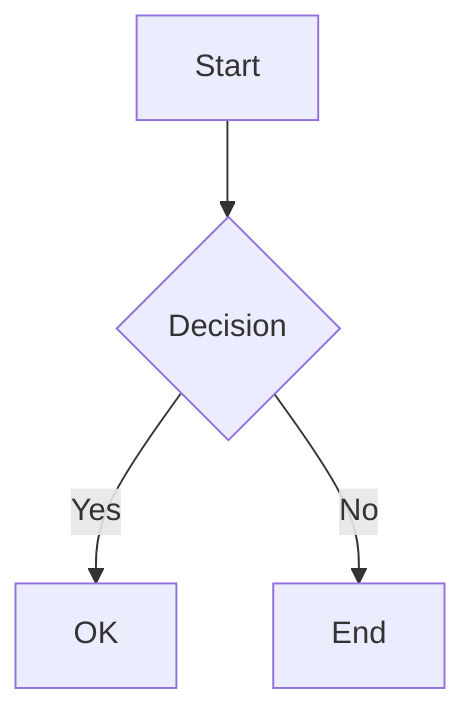
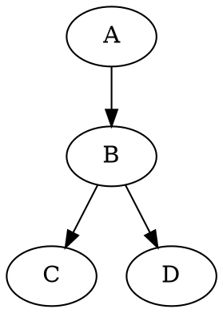
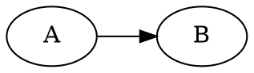
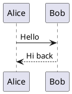

# MarkdownRenderer

Shared markdown-to-HTML rendering utility for the Enterprise Theme. Converts markdown to styled HTML using [marked](https://marked.js.org/) with optional extensions for code highlighting, math, and diagrams. Zero CSS injection — renders using the theme's native fonts and colours.

## Dependencies

### Required

| Library | Global | Version | Purpose |
|---------|--------|---------|---------|
| [marked](https://marked.js.org/) | `window.marked` | 15.0.7 | Markdown parsing |

### Optional (auto-detected)

These libraries are probed on `window` at render time. If present, they are used automatically. If absent, the corresponding features are silently skipped.

| Library | Global | Version | Purpose |
|---------|--------|---------|---------|
| [highlight.js](https://highlightjs.org/) | `window.hljs` | 11.11.1 | Code syntax highlighting |
| [KaTeX](https://katex.org/) | `window.katex` | 0.16.22 | LaTeX/MathML math rendering |
| [Mermaid](https://mermaid.js.org/) | `window.mermaid` | 11.17.2 | Mermaid diagrams |
| [@viz-js/viz](https://viz-js.com/) | `window.Viz` | 3.11.0 | Graphviz/dot diagrams (client-side WASM, no server) |

### Loading them, with subresource integrity

This repository does not serve these libraries, so the host page chooses the
build. Every tag below carries the hash of the exact build named above. A
substituted file fails the check, the browser refuses it, and the global is
absent. Copy the tags as they stand.

The same hashes are published as machine-readable JSON at
`/third-party-sri.json`. Run `npm run sri:verify` to refetch each URL and
diff. DEBT-SEC-5 records why these are hashed rather than vendored here.

```html
<!-- Required -->
<script src="https://cdn.jsdelivr.net/npm/marked@15.0.7/marked.min.js"
        integrity="sha384-H+hy9ULve6xfxRkWIh/YOtvDdpXgV2fmAGQkIDTxIgZwNoaoBal14Di2YTMR6MzR"
        crossorigin="anonymous"></script>

<!-- Optional: code highlighting -->
<script src="https://cdn.jsdelivr.net/gh/highlightjs/cdn-release@11.11.1/build/highlight.min.js"
        integrity="sha384-RH2xi4eIQ/gjtbs9fUXM68sLSi99C7ZWBRX1vDrVv6GQXRibxXLbwO2NGZB74MbU"
        crossorigin="anonymous"></script>
<link rel="stylesheet" href="https://cdn.jsdelivr.net/gh/highlightjs/cdn-release@11.11.1/build/styles/github.min.css"
      integrity="sha384-eFTL69TLRZTkNfYZOLM+G04821K1qZao/4QLJbet1pP4tcF+fdXq/9CdqAbWRl/L"
      crossorigin="anonymous">

<!-- Optional: math -->
<script src="https://cdn.jsdelivr.net/npm/katex@0.16.22/dist/katex.min.js"
        integrity="sha384-cMkvdD8LoxVzGF/RPUKAcvmm49FQ0oxwDF3BGKtDXcEc+T1b2N+teh/OJfpU0jr6"
        crossorigin="anonymous"></script>
<link rel="stylesheet" href="https://cdn.jsdelivr.net/npm/katex@0.16.22/dist/katex.min.css"
      integrity="sha384-5TcZemv2l/9On385z///+d7MSYlvIEw9FuZTIdZ14vJLqWphw7e7ZPuOiCHJcFCP"
      crossorigin="anonymous">

<!-- Optional: Mermaid diagrams -->
<script src="https://cdn.jsdelivr.net/npm/mermaid@11.17.2/dist/mermaid.min.js"
        integrity="sha384-EOXBFmc3gx5mb+vn0vPvvGqACToJD24hhacX5Yx+8NUUQrHIle/Qi5Bg9o3zKwW2"
        crossorigin="anonymous"></script>

<!-- Optional: Graphviz diagrams -->
<script src="https://cdn.jsdelivr.net/npm/@viz-js/viz@3.11.0/lib/viz-standalone.js"
        integrity="sha384-6ECxW8G4FmLMEr8fKkk617NsYhxb7AhsiyyT6Gey/Sru4R+lyRpVM12ekzlOD08g"
        crossorigin="anonymous"></script>
```

### PlantUML (server-based)

PlantUML diagrams are rendered by sending the source text to a PlantUML server which returns SVG. **No client-side library is needed.**

- **Default server**: `https://www.plantuml.com/plantuml/svg/` (public, community-maintained, no SLA)
- **Recommended for production**: Self-host a PlantUML server via Docker:
  ```bash
  docker run -d -p 8080:8080 plantuml/plantuml-server:jetty
  ```
  Then configure: `plantumlServer: "http://localhost:8080/svg/"`

The encoding uses native `CompressionStream('deflate-raw')` + PlantUML's custom base64 — no encoder library needed.

## Usage

### Basic (markdown only)

```html
<script src="marked.min.js"></script>
<script src="markdownrenderer.js"></script>
<script>
var renderer = createMarkdownRenderer();
renderer.render("# Hello\n\nSome **bold** text.", targetElement);
</script>
```

### With code highlighting

```html
<link rel="stylesheet" href="highlight.js/styles/github.min.css">
<script src="marked.min.js"></script>
<script src="highlight.min.js"></script>
<script src="markdownrenderer.js"></script>
<script>
var renderer = createMarkdownRenderer();
renderer.render("```js\nconsole.log('hi');\n```", targetElement);
</script>
```

### With all extensions

```html
<link rel="stylesheet" href="highlight.js/styles/github.min.css">
<link rel="stylesheet" href="katex/dist/katex.min.css">
<script src="marked.min.js"></script>
<script src="highlight.min.js"></script>
<script src="katex.min.js"></script>
<script src="mermaid.min.js"></script>
<script src="viz-standalone.js"></script>
<script src="markdownrenderer.js"></script>
<script>
var renderer = createMarkdownRenderer({
    plantumlServer: "http://localhost:8080/svg/"
});
renderer.render(markdownContent, targetElement);
</script>
```

### Configuration options

```typescript
createMarkdownRenderer({
    highlight: true,        // Use highlight.js if available (default: true)
    math: true,             // Use KaTeX if available (default: true)
    mermaid: true,          // Use Mermaid if available (default: true)
    graphviz: true,         // Use @viz-js/viz if available (default: true)
    plantuml: true,         // Enable PlantUML server rendering (default: true)
    plantumlServer: "...",  // PlantUML server URL (default: public server)
    className: "my-md",     // Extra class on the element render() writes into
});
```

### `highlight` and `math` are decided once per page

`marked` is a global singleton and `marked.use()` mutates it, so the
**first** renderer created in a page configures its extensions. A later
`createMarkdownRenderer` that names a *different* `highlight` or `math`
**throws**, because the call cannot be honoured without changing the
renderer the first caller is holding:

```
[MarkdownRenderer] marked is already configured with math: true, and
this call asks for false. marked.use() is global, so the first renderer
on a page decides. Create one renderer with the options you want, or
reload marked before changing them.
```

A later call naming the same values, or naming neither, is fine — which
is the ordinary case, since most callers pass no options at all. Every
other option is read per render and can differ freely between handles.

Before 2026-10-21 the second call was silently given the first one's
extensions.

### `className` applies to `render()` only

`render(md, target)` adds the class to `target`. `toHtml(md)` returns a
string and has no wrapper to carry it.

### Disabling specific features

```typescript
// Only markdown + code highlighting, no diagrams or math
createMarkdownRenderer({
    math: false,
    mermaid: false,
    graphviz: false,
    plantuml: false,
});
```

## API

### `createMarkdownRenderer(opts?): MarkdownRendererHandle`

Creates a renderer instance. Registered on `window.createMarkdownRenderer`.

### `MarkdownRendererHandle`

| Method | Description |
|--------|-------------|
| `render(md, target)` | Render markdown into a DOM element. Runs async post-processing for diagrams. |
| `toHtml(md)` | Convert markdown to sanitised HTML string. Does **not** process diagrams (they require DOM). |

## Supported markdown features

### Standard markdown
Headings, paragraphs, bold, italic, links, images, lists, blockquotes, horizontal rules, tables.

### Code blocks
Fenced code blocks with language tags. Syntax highlighted when highlight.js is loaded.

````markdown
```javascript
function greet() { console.log("hello"); }
```
````

### Math (KaTeX)
Inline math with `$E = mc^2$` and block math with:

```markdown
$$
\int_0^\infty e^{-x^2} dx = \frac{\sqrt{\pi}}{2}
$$
```

### Mermaid diagrams

````markdown

````

### Graphviz / dot diagrams

Rendered entirely client-side via `@viz-js/viz` (WASM). No server needed.

````markdown

````

Also supports the `graphviz` language tag:

````markdown

````

### PlantUML diagrams

Rendered by a server. The source is deflate-compressed, base64-encoded, and fetched as SVG.

**The reply is shown as an image, not as markup.** The component puts the SVG
into a data URL and sets it as the source of an `img` element. A browser runs
no script in an SVG that it loads as an image. The reply comes from a third
party under the default option. This removes every variant of script
injection through that path, where a filter would remove only the vectors
somebody listed (SEC-3, ADR-164).

Three effects follow from that decision:

- Text inside a PlantUML diagram is not selectable, and the browser cannot find it with a page search.
- A link inside a PlantUML diagram does not work.
- CSS that targets the `svg` element inside `.md-diagram` does not reach a PlantUML diagram. Target `.md-diagram-image` instead.

The diagram source stays available in two places. The placeholder keeps its
`data-source` attribute. The component also adds a visually hidden `pre`
element holding the source and points the image at it with
`aria-describedby`, which is the long-description pattern for a complex image.

Mermaid and Graphviz are not affected. Both render on the local machine from
source the document author wrote, and neither inserts a markup string.

````markdown

````

## Security

The component has two inputs, and it treats them differently on purpose.

- **Markdown from the consumer is sanitised.** `<script>`, `<iframe>`, `<object>`, `<embed>` and `<form>` elements are stripped. Event-handler attributes such as `onclick` and `onload` are removed, and so are `javascript:` URLs.
- **A PlantUML reply is never parsed as markup.** It is loaded as an image through a data URL, so a hostile or compromised server cannot run script in the page (SEC-3, ADR-164). The sanitiser is a list of forbidden things, which is weaker than this for SVG, because SVG can carry `<use>`, `<animate>`, `<set>`, `<foreignObject>` and `<style>`.
- PlantUML server calls send only diagram source text. They send no cookies and no credentials.
- Consumer-provided markdown is never trusted.

## Architecture

The renderer is designed as a thin orchestration layer:

```
[marked]  ──parse──>  HTML string  ──sanitize──>  Safe HTML
                          │
              ┌───────────┼───────────┐
              │           │           │
         [highlight.js] [KaTeX]   [code blocks]
                                      │
                            ┌─────────┼─────────┐
                            │         │         │
                       [Mermaid]  [Viz.js]  [PlantUML]
                       (client)  (client)  (server)
```

- **marked** handles all parsing and standard HTML generation
- **highlight.js** is wired into marked's code renderer
- **KaTeX** is wired as a marked tokenizer/renderer extension
- **Mermaid**, **Graphviz**, and **PlantUML** are post-render steps that find placeholder `<div>` elements and replace them with rendered diagrams

## Used by

- **HelpDrawer** — slide-out documentation panel
- **DocViewer** — three-column documentation layout

Both components call `window.createMarkdownRenderer()` internally. Load `markdownrenderer.js` before their scripts.
